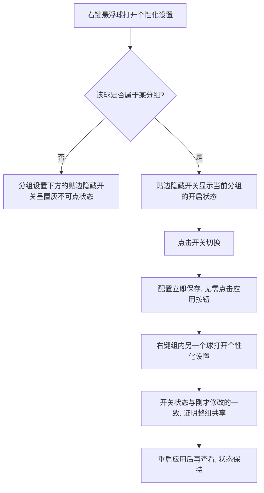
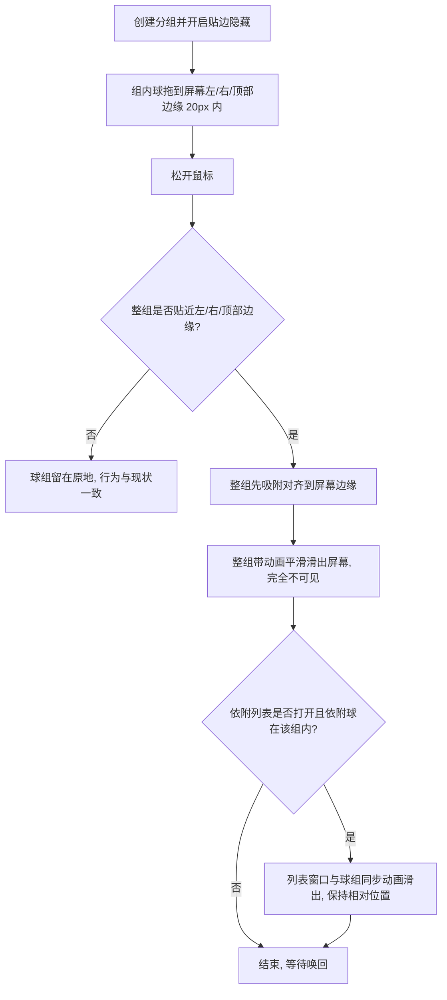
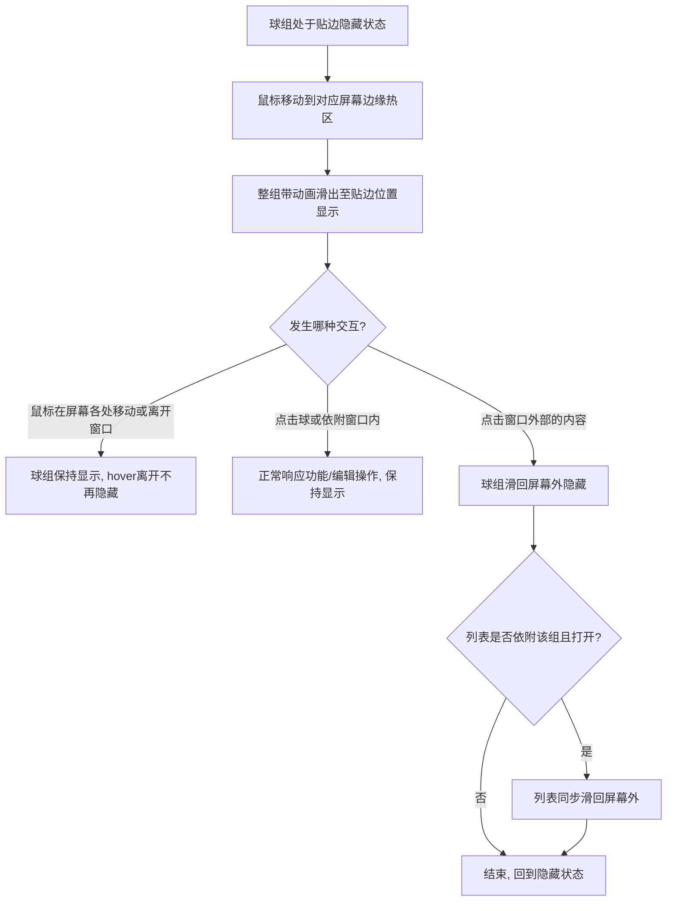
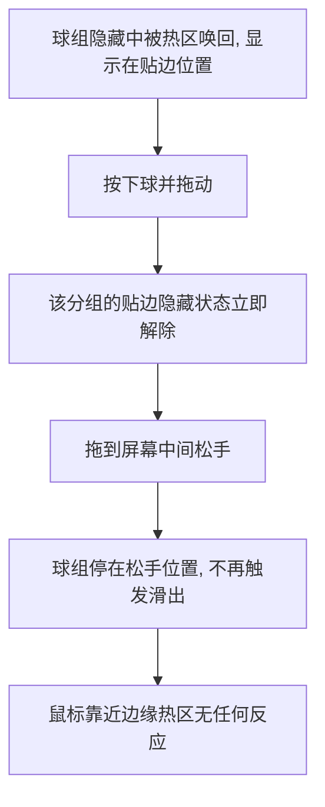
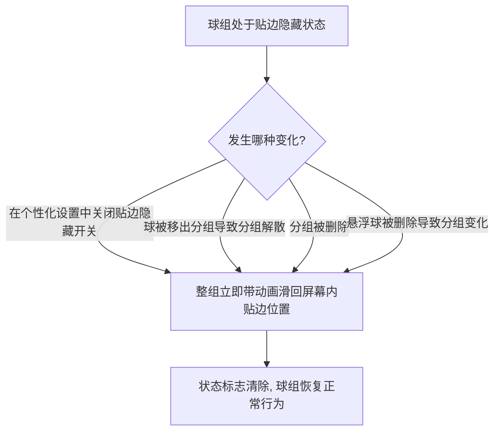
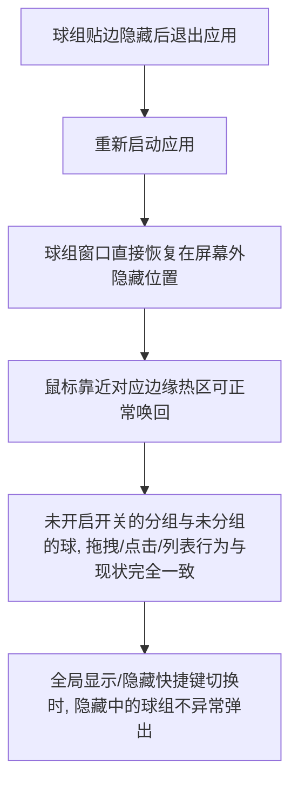
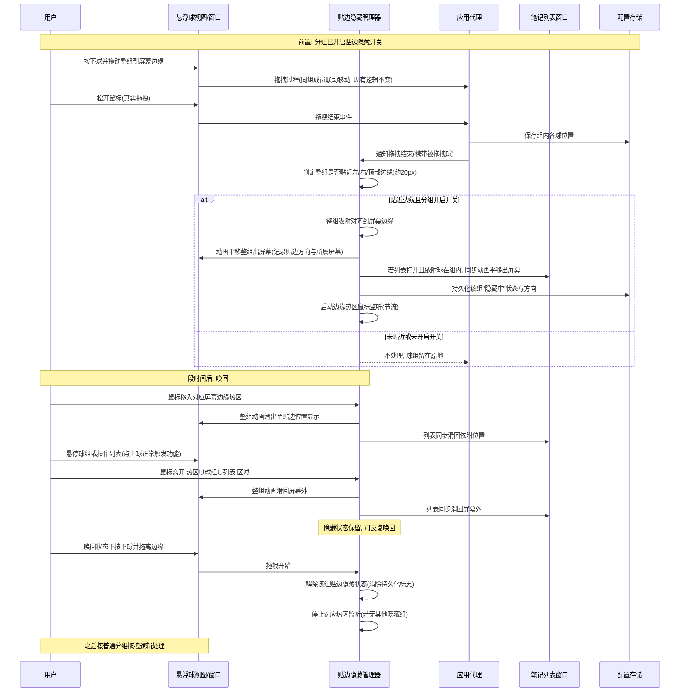
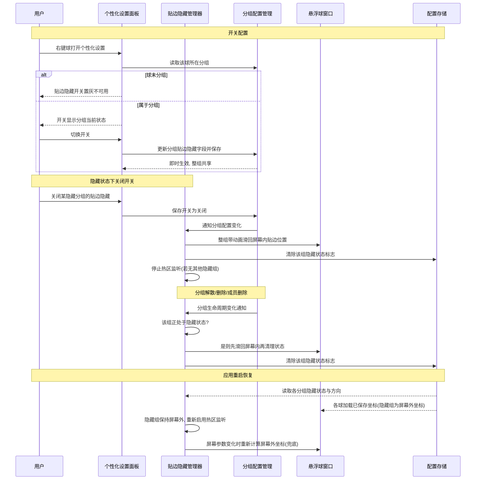

# 悬浮球组贴边隐藏

## 测试用例

### 用例一：开关配置（分组绑定）

### 用例二：贴边隐藏触发（含列表同步）

### 用例三：热区唤回与滑回

### 用例四：拖离解除贴边状态

### 用例五：关闭开关与分组解散恢复

### 用例六：重启与兼容性

## 方案

### 推荐方案概述

在现有悬浮球分组体系上，新增一个集中式的「贴边隐藏管理器」（单例，风格对齐现有自动隐藏管理器），统一承载贴边隐藏的完整状态机；分组模型上新增持久化的「贴边隐藏」开关，随现有配置体系保存并向后兼容。

核心思路分四部分：

1. **配置层**：分组配置新增「贴边隐藏」布尔字段，默认关闭，随现有 JSON 配置持久化，解码时对旧数据自动补默认值。配置入口放在悬浮球个性化设置面板的分组设置区域（排列方式）下方，未分组的球开关置灰，改动即时保存并对整组生效。

2. **触发与滑出**：接入现有分组拖拽结束事件。真实拖拽（区别于纯点击）松手后，若整组贴近屏幕左、右或顶部边缘（判定距离约 20px），管理器先将整组吸附对齐到边缘，再以两段式动画将整组（含依附的列表窗口）平移出屏幕。顶部滑出位置避让菜单栏，完全不可见。

3. **唤回与滑回**：管理器在存在隐藏分组期间启用全局鼠标移动监听（用于屏幕边缘热区检测唤回）与全局/本地鼠标点击监听。鼠标进入热区则整组滑出至贴边位置；鼠标离开窗口（hover离开）不再触发隐藏，仅在用户点击窗口外部的内容时整组（含列表）滑回屏幕外隐藏。滑出显示期间按下球即解除该组的贴边隐藏状态，之后的拖拽与松手按普通分组逻辑处理。

4. **位置与状态持久化**：窗口坐标照常走现有按球保存的通道（滑出动画结束后自然保存屏幕外坐标）；管理器按分组另存「隐藏中」状态与贴边方向。因滑出前已吸附对齐，唤回位置可由方向直接推导，无需双份记录隐藏前坐标。应用启动时按状态标志把隐藏组的窗口直接放在屏幕外位置；关闭开关、解散分组、删除分组、删除成员球等生命周期事件发生时，若该组正处于隐藏状态则先滑回屏幕内再清理状态，杜绝窗口遗留在屏幕外找不回。监听屏幕参数变化，分辨率变更时对隐藏组重新计算屏幕外坐标作为兜底。

### 优缺点

优点：
- 状态机集中在管理器内，悬浮球窗口、应用代理、列表窗口只被动响应指令，避免逻辑散落多文件
- 「先吸附再滑出」使唤回位置可由方向推导，不引入第二份坐标存储，避免位置不一致
- 全局鼠标监听仅在存在隐藏分组时启用并做事件节流，空闲时零开销
- 配置向后兼容，旧版本数据可正常解码升级
- 生命周期兜底完整（关开关/解散/删组/删球/换屏幕），不会出现球丢失在屏幕外

缺点与风险：
- 全局鼠标移动监听在高频移动时持续触发，虽已节流仍有轻微常驻开销（仅在隐藏期间存在，可接受）
- 顶部隐藏的唤回需要鼠标越过菜单栏进入屏幕最顶部条带，交互灵敏度略低于左右两侧
- 列表窗口较高时同步滑出的位移较大，动画视觉略明显
- 屏幕外窗口在极少数系统场景（如分辨率热切换）下坐标可能失效，需依赖屏幕变化兜底逻辑

### Mermaid 时序图

#### 主流程：拖拽贴边隐藏与热区唤回

#### 生命周期流程：开关、分组变更、启动恢复

